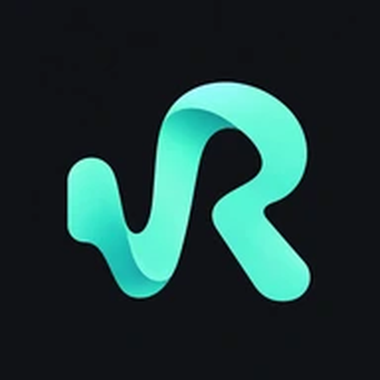
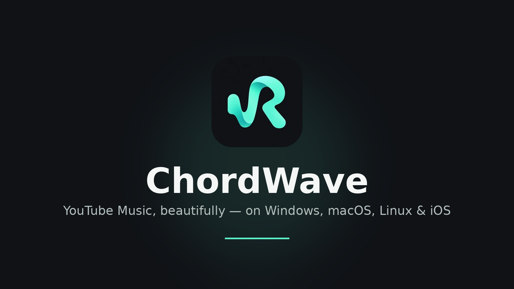

<div align="center">



# ChordWave

**An open-source music client for Windows, macOS, Linux, iPhone and iPad.**<br>
YouTube Music, your own library, DJ-style Automix and Hi-Res playback — free, no ads.

<br>

[](https://github.com/Rikki53/ChordWave-Multiplatform/releases/latest)
[](LICENSE)
[](#download)

[](shared)
[](desktopApp)

<br>

**[Download](#download)** · **[Features](#features)** · **[Install](#install)** · **[Attribution](#attribution)** · **[Disclaimer](#disclaimer)**

<br>



</div>

> [!NOTE]
> ChordWave is the full desktop app. Looking for the lightweight Windows-only build instead? See [ChordWave Lite](https://github.com/Rikki53/BitChord-PC-Continued). The Android phone app lives in [Rikki53/ChordWave](https://github.com/Rikki53/ChordWave); the Android, TV and Wear modules in this repository are the same codebase's phone builds, kept for development.

---

## <a id="download"></a>Download

One release per version carries every platform. Grab the latest from the
**[releases page](https://github.com/Rikki53/ChordWave-Multiplatform/releases/latest)**:

| Platform | File | Notes |
|---|---|---|
| Windows | `ChordWave-<version>-windows-x64-setup.exe` | Recommended installer (per-user, no admin needed) |
| Windows | `ChordWave-<version>-windows-x64-portable.zip` | Unzip and run `ChordWave.exe`, no install |
| Windows | `ChordWave-<version>-windows-x64.msi` | For managed deployments |
| macOS Apple Silicon | `ChordWave-<version>-macos-arm64.dmg` | M1/M2/M3/M4 and later |
| macOS Intel | `ChordWave-<version>-macos-x64.dmg` | Intel Macs |
| macOS | `ChordWave-<version>-macos-*.pkg` / `.zip` | Installer package / app bundle archive |
| Linux | `ChordWave-<version>-linux-x86_64.AppImage` | `chmod +x` and run on any distribution |
| Linux | `ChordWave-<version>-linux-amd64.deb` | Debian, Ubuntu and derivatives |
| Linux | `ChordWave-<version>-linux-x86_64.rpm` | Fedora, RHEL and openSUSE |
| iOS | `ChordWave-<version>-ios-unsigned.ipa` | Sideload (see below) |

Every desktop download carries its own Java runtime, the FFmpeg and ONNX natives, the Automix analyser and its models. Nothing else has to be installed first — no JDK, no codec pack.

---

## <a id="install"></a>Install

### 🪟 Windows (10 & 11)

**Option A — Setup Installer (Recommended):**
1. Download **`ChordWave-<version>-windows-x64-setup.exe`** from the [releases page](https://github.com/Rikki53/ChordWave-Multiplatform/releases/latest).
2. Run the `.exe` installer. It installs for the current user (no administrator permission required) and creates shortcuts in your Start Menu and Desktop.
3. **SmartScreen Notice:** If Windows SmartScreen displays a warning (*"Windows protected your PC"*), click **More info** and select **Run anyway**.

**Option B — Portable (.zip):**
1. Download **`ChordWave-<version>-windows-x64-portable.zip`**.
2. Extract the archive to any folder or external drive.
3. Launch **`ChordWave.exe`** directly without installation.

### 💻 Mac (Apple Silicon & Intel)

1. Download the `.dmg` for your Mac — `macos-arm64` for Apple Silicon, `macos-x64` for Intel — from the [releases page](https://github.com/Rikki53/ChordWave-Multiplatform/releases/latest).
2. Open the `.dmg` file and drag **ChordWave.app** into your **Applications** folder.
3. **Gatekeeper Notice:** Because this is an open-source build without an Apple Developer ID signature, Gatekeeper may display a prompt on the first launch (*"ChordWave is from an unidentified developer"*).  
   You can easily open it by running this command in Terminal:
   ```sh
   xattr -cr /Applications/ChordWave.app
   ```
   Or right-click (Control-click) `ChordWave.app` in Finder and select **Open**.

### 🐧 Linux

- **AppImage:** `chmod +x ChordWave-*.AppImage` and run it.
- **deb:** `sudo apt install ./ChordWave-*.deb`
- **rpm:** `sudo dnf install ./ChordWave-*.rpm`

### 📱 iPhone & iPad (Sideloading)

1. Download **`ChordWave-<version>-ios-unsigned.ipa`** from the [releases page](https://github.com/Rikki53/ChordWave-Multiplatform/releases/latest).
2. Sideload it using your preferred sideloading tool:
   - **AltStore / SideStore**: Open the IPA in the app and sign with your Apple ID.
   - **Sideloadly**: Connect your device, drag the IPA into Sideloadly, and click Start.
   - **TrollStore** (if supported on your iOS version): Install directly without revokes.
   - **Scarlet**: Direct on-device installation.
3. If prompted by iOS, go to **Settings → General → VPN & Device Management** and trust your developer certificate.

---

<div align="center">


<h1><a id="features"></a>Features</h1>

<table>
  <tr>
    <td width="50%" valign="top">

#### Playback
- **Search, browse and play** anything available on YouTube Music.
- **Hi-Res lossless audio** — FLAC/ALAC from a configured module source, with YouTube Music as fallback.
- **Gapless playback with true crossfade**, adjustable 0–12s.
- **Automix [Beta]** — DJ-style transitions with beat-matching and tempo-stretching.
- **Offline downloads** — save tracks with embedded metadata.
- **Local music library** integration.
- **Background playback** via a proper foreground media session.
- **Apple-like lyrics animation** — credit to [binimum](https://github.com/binimum/am-lyrics).

#### Connectivity & Accounts
- **Sign in with your Google account** for personalized content.
- **Spotify integration** — connect your account to play your playlists and Liked Songs.
- **Listen Together** — synced listening parties, hosted on ChordWave's own party server by default; a custom server can be configured in Settings.
- **Discord Rich Presence** — in-app login, live track/artist/album and progress.
- **Scrobbling** to Last.fm and ListenBrainz.
- **Pluggable sources** — add, edit, test and health-check module sources.

    </td>
    <td width="50%" valign="top">

#### Experience
- **Animated album canvas** — motion artwork on the now-playing screen.
- **Word-synced lyrics** — word/syllable-level highlighting from multiple sources.
- **Lyrics providers** — credit to [lrc.red](https://lrc.red), [BiniLyrics](https://github.com/binimum), [BetterLyrics](https://github.com/better-lyrics/better-lyrics), [PaxSenix](https://lyrics.paxsenix.org), [LyricsPlus](https://github.com/ibratabian17/YouLyPlus), [SimpMusic](https://github.com/maxrave-dev/SimpMusic), [Unison](https://unison.boidu.dev), [Megalobiz](https://www.megalobiz.com), [KuGou](https://www.kugou.com), [LRCLIB](https://lrclib.net), [Musixmatch](https://www.musixmatch.com) and [Genius](https://genius.com).
- **Dynamic, artwork-driven theming** — Material palette extracted from album art.
- **Frosted-glass UI** — Telegram-style translucent bars via Haze, Material 3 theming.

#### Controls & Tweaks
- **Per-network audio quality** — separate quality ceilings for Wi-Fi and mobile data.
- **Playback speed control** (0.5×–2.0×) and **skip silence**.
- **Sleep timer** — fixed presets or "stop after this track".
- **System equalizer** integration.
- **Bit-perfect USB exclusive output** — sends lossless tracks to a USB DAC unchanged, at each track's own rate and bit depth. Thanks to [Mornye](https://github.com/mornyeapp/Mornye) for the reference.
- **Stats for nerds** — codec, bit depth, sample rate, and more on the now-playing screen.

    </td>
  </tr>
</table>

</div>

---

<div align="center">

<h1><a id="attribution"></a>Attribution</h1>

ChordWave stands on other people's work, and says so:

- **Original BitChord** for Android by [Kushagra Singh](https://github.com/kushagrasinghx) — [kushagrasinghx/BitChord](https://github.com/kushagrasinghx/BitChord).
- **Desktop & iOS port** (Kotlin Multiplatform + Compose Multiplatform) by [fumakill4](https://github.com/fumakill4) — [fumakill4/BitChord](https://github.com/fumakill4/BitChord).
- **Rebranded as ChordWave** by [Riki Nurjaman](https://github.com/Rikki53).

This repository is a standalone copy: it keeps the full history of the port it came from, under the same GPL-3.0 license.

</div>

---

<div align="center">

<h1><a id="support"></a>Support</h1>

ChordWave is free and always will be — no ads, no paywall.

If something breaks or you have an idea, please [open an issue](https://github.com/Rikki53/ChordWave-Multiplatform/issues).

</div>

---

<div align="center">

<h1><a id="disclaimer"></a>Disclaimer & Legal Notice</h1>

ChordWave is an independent, community-driven third-party audio player and client. It is **not** associated with Google LLC, YouTube Music, Deezer, Telegram, or any of their parent companies.

* **No Media Hosting:** ChordWave does not host, upload, or store copyrighted music files. It operates strictly as an interface to scan local device storage or stream media directly from public, public-facing, or user-authenticated APIs.
* **Fair Use & API Usage:** This software is created solely for personal research, educational, and fair-use purposes. The user is entirely responsible for ensuring their usage aligns with their local copyright laws and YouTube Terms of Service.
* **No Ad-Blocking Guarantee:** While ChordWave focuses on providing a clean listening environment, it does not guarantee permanent bypasses or modifications to commercial third-party platform conditions.
* **Copyleft:** ChordWave is free software under the GPLv3. The license does not let anyone forbid others from selling or redistributing copies, but any distribution must come with the Corresponding Source under the same license.

</div>

---

<div align="center">

<h1><a id="license"></a>License</h1>

This project is licensed under the **GNU General Public License v3.0 (GPLv3)**. See the [LICENSE](LICENSE) file for details.

</div>
